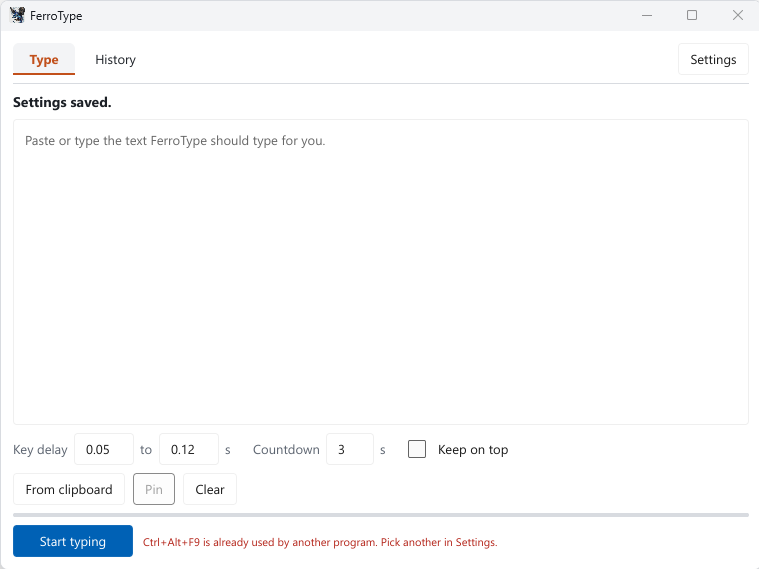
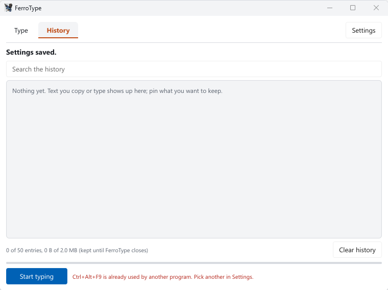
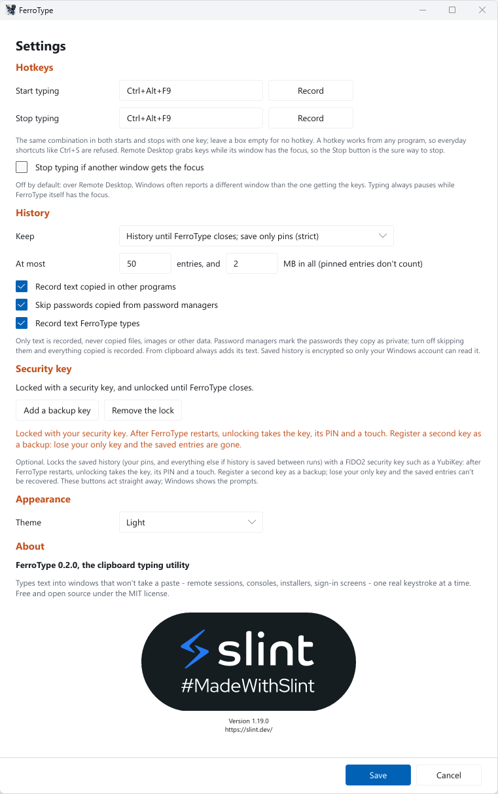

# FerroType

**The clipboard typing utility.** FerroType types text into windows that won't take a paste:
remote sessions, virtual machine consoles, installers, sign-in screens, web consoles. It presses
real keys, one at a time, the way you would.

Written in Rust with a [Slint](https://slint.dev) UI. One small exe, nothing to install.

> **Status: v0.2.0.** Typing, start/stop hotkeys, history with pins, settings, an optional
> security-key (YubiKey) lock on the saved history, and an optional install.

<p align="center">
  
  
</p>

## Download

**[Download the latest `ferrotype.exe`](https://github.com/Freeflite/FerroType/releases/latest)**:
one file, 64-bit Windows 10 or 11. It isn't code-signed, so the first run shows SmartScreen's
"Windows protected your PC"; choose **More info → Run anyway**. Each release lists SHA-256
checksums and has a signed build-provenance attestation
(`gh attestation verify ferrotype.exe --repo Freeflite/FerroType`), or
[build it yourself](#building).

Run it from wherever you put it, or press **Settings → Installation → Install**. That copies it to
`%LOCALAPPDATA%\Programs\FerroType` and adds it to the Start menu and to Settings → Apps, for
your Windows account only (no administrator rights). A newer download offers to update the
installed copy. **Uninstall** (there, or in Settings → Apps) removes it again. Your settings and
history are kept in `%APPDATA%\FerroType` either way.

Only one FerroType runs at a time: starting it again brings the running one to the front.

## Using it

1. Put the text in the **Type** tab: type it, paste it, or press **From clipboard**.
2. Press **Start typing** (or the hotkey, **Ctrl+Alt+F9** to start with), then click into the
   window it should go to before the countdown ends.
3. FerroType types it there. Press **Stop**, or the hotkey again, to stop.

The **History** tab keeps what you've copied and typed. Click a line to put it back in the editor,
or press its **▶** to type it straight away. **Pin** what you type often and it stays until you
unpin it.

### How it types

- **Real keystrokes.** Each character is pressed with the key that makes it on the target
  window's keyboard layout, with Shift when needed. Many typing tools send "Unicode packets"
  instead, which some programs, remote sessions and VM consoles ignore. Only characters with no
  key of their own (like emoji) go as Unicode packets; keys that need Ctrl or AltGr are never
  pressed, since they could set off shortcuts.
- **A random pause after each key** (Key delay, 0.05 to 0.12 s to start with), so remote
  sessions keep up and nothing types at a machine-perfect rhythm. Raise it if characters go
  missing; lower it for long text. The status line shows how long is left.
- **It keeps typing when the focus moves.** Over Remote Desktop, Windows often reports a
  different window than the one getting the keys, so FerroType doesn't stop for that (turn on
  *Stop typing if another window gets the focus* in Settings if you'd rather it did).
- **It never types into itself.** While FerroType's own window has the focus, typing waits, so
  clicking **Stop** is always safe.
- **It never types over held keys.** While Ctrl, Alt, Shift or Win is down (say, from the
  hotkey), it waits, so keystrokes can't turn into shortcuts.
- **Locked screen or UAC prompt?** Windows refuses keystrokes then; FerroType waits and carries
  on afterwards, without doubling a character.

### Hotkeys

Set a start and a stop hotkey in **Settings** (the same combination for both starts and stops
with one key), by typing it or pressing **Record**. A hotkey works from any program, so
FerroType refuses combinations that would get in the way: everyday shortcuts like Ctrl+S,
Windows' own (Alt+Tab, Alt+F4…), and the ones Remote Desktop keeps for itself (Alt+Page Up,
Ctrl+Alt+End…). F-keys work on their own or with modifiers.

While a Remote Desktop window has the focus, it may grab keys before FerroType sees them; the
**Stop** button always works.

### History and pins

- **Text only.** FerroType records text you copy in other programs, text you pull in with
  **From clipboard**, and text it types; never copied files, images or other data.
- **Passwords are skipped.** Password managers mark the passwords they copy as private, and
  FerroType doesn't record those. Turn off *Skip passwords copied from password managers* in
  Settings and it records every copy. Copies out of Remote Desktop and VM windows are recorded
  either way. **From clipboard** always adds its text, since you asked for it.
- **You choose what's kept** (Settings → History):
  - *No history*: only what you pin.
  - *History until FerroType closes; save only pins* (strict, the default).
  - *History saved between runs*.
- **Limits:** at most 50 entries and 2 MB to start with, both adjustable; the oldest entries go
  first. Pinned entries don't count and are never dropped.
- **Saved history is encrypted** with Windows' data protection (DPAPI), so only your Windows
  account can read it. It's kept in `%APPDATA%\FerroType\history.dat`; settings are in
  `settings.ini` next to it.

### Locking it with a security key (optional)

Got a YubiKey or another FIDO2 security key? **Settings → Security key → Lock with a security
key** locks the saved history with it: your pins, and everything else if history is saved
between runs. After FerroType restarts, the History tab shows **Unlock**, and unlocking takes the
key, its PIN and a touch. Someone who gets into your Windows account, or copies the file, can't
read it without the key.

<p align="center">
  
</p>

- **Register a backup key** (**Add a backup key**). Any registered key unlocks the history. Lose
  your only key and the saved entries can't be recovered: there's no back door.
- **Windows does the asking.** FerroType goes through Windows' own security-key API, which shows
  its own PIN and touch prompts, so FerroType never sees your PIN. No administrator rights and no
  network needed, and the key's passkey slots aren't used.
- **How it works:** a random key encrypts the history (AES-256-GCM). That key is stored once per
  registered security key, encrypted with a key derived from the security key's `hmac-secret`
  answer, which only that security key can give, and only with its PIN and a touch. Windows' DPAPI
  still wraps the whole file.
- **While it's locked** FerroType still types, and records new copies until it closes; pins you add
  are saved once you unlock. Once unlocked, it stays unlocked until FerroType closes.
- **Lost a key?** Unlock with another one, press **Remove the lock**, then register your keys
  again: that starts over with a new encryption key.
- Needs a key with FIDO2 `hmac-secret` (YubiKey 5 and Security Key series, and most others) and
  Windows 11 (or a recent Windows 10).

## What FerroType doesn't do

- **No network access.** No telemetry, no update checks, nothing sent anywhere.
- **No keyboard hook.** Hotkeys are registered with Windows (`RegisterHotKey`) and copies are
  noticed through Windows' clipboard notifications; FerroType never watches what you type.
- **No administrator rights.** It runs as you. (Windows won't let it type into a program running
  as administrator unless FerroType is too.)

See [SECURITY.md](SECURITY.md) for more, and how to report a problem.

## Building

You need Rust (the toolchain in `rust-toolchain.toml` installs itself) and the Visual Studio
Build Tools with the C++ workload.

```powershell
cargo build --release              # target\release\ferrotype.exe
cargo test --workspace             # unit tests
pwsh scripts/build-release.ps1     # the release build: hardened, reproducible, no build paths
```

The release build is reproducible with the same toolchain: building a commit twice gives the
same exe, byte for byte. A different Visual Studio linker version gives a different one, which is
why each release carries a build-provenance attestation saying exactly where its exe came from.

The workspace has three crates:

- `ferrotype-core`: the typing loop, hotkeys, history, settings and the security-key vault. No
  `unsafe`, no Windows calls, all unit-tested.
- `ferrotype-sys`: the Win32 layer (keystrokes, hotkeys, clipboard, DPAPI, security keys,
  installing), the only crate allowed `unsafe`; every unsafe block is one operation with a
  `SAFETY:` comment.
- `ferrotype`: the Slint app.

## License

MIT; see [LICENSE](LICENSE) and [THIRD-PARTY-NOTICES.md](THIRD-PARTY-NOTICES.md).
